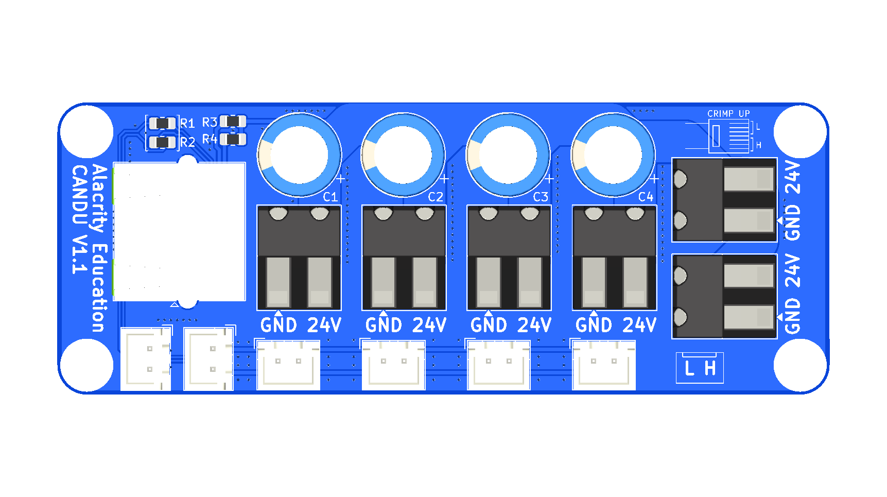
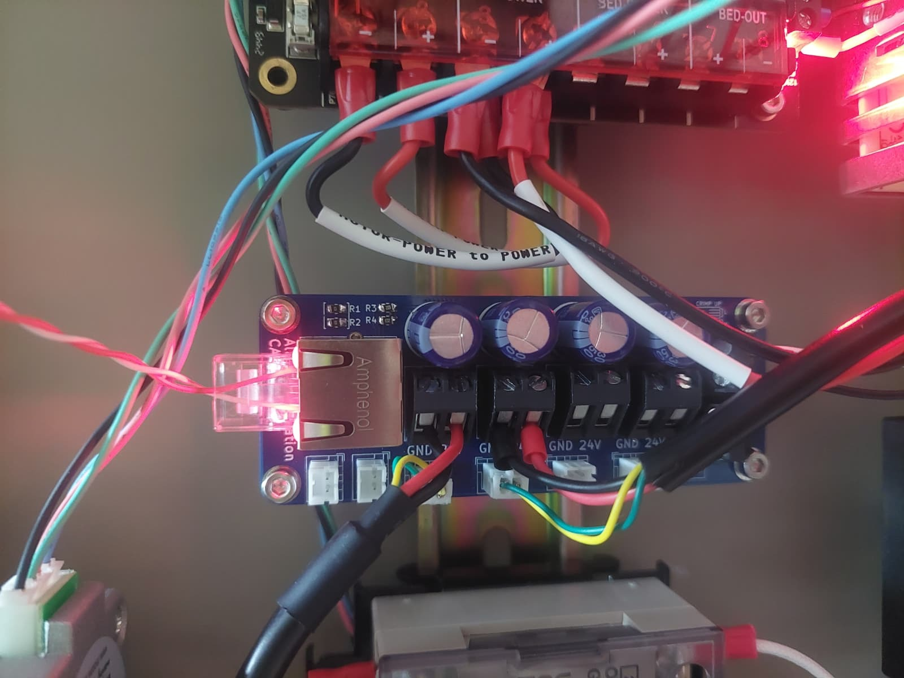

# CANDU V1.1

A passive CAN bus and 24V distribution board. The CAN bus and 24V come in
once, from the host side, and go out to up to four devices (toolhead boards,
for example). Each device port is a pair: a screw terminal for 24V and a
JST-XH connector for CAN, placed one above the other.

The board has no active parts: every CAN connector is on the same bus, and
every power terminal is on the same 24V rail.

|  |  |
| -- | -- |

## Host side

**RJ45**: CAN bus input. The two RJ45 LEDs light up when the board has 24V.

## Device ports

Four ports providing CAN and power to 4 toolheads or devices. 

## Swapping CAN H and L on the RJ45

If the upstream cable carries CAN H and L the other way round, swap them on
the board instead of re-crimping the cable. R1 and R2 are two 0 Ω links whose
four pads form a square:

- **Straight (as built):** both links horizontal. RJ45 pins 5-8 go to CAN H,
  pins 1-4 to CAN L.
- **Swapped:** desolder both links and fit them vertically, on the dashed
  outlines. RJ45 pins 1-4 go to CAN H, pins 5-8 to CAN L.

The swap only affects the RJ45 uplink.

## Notes

- The CAN bus needs a 120 Ω terminator at each end. The board has none, so terminate at the host and at the last device.
- If using long cables to the 2-4 devices, terminate at two devices instead of at the host. In this case, make sure the CANDU-Host cable is short. 
- Four 330 µF high-quality capacitors (C1-C4) buffer the 24V rail.
- M3 mounting holes are connected to GND.
