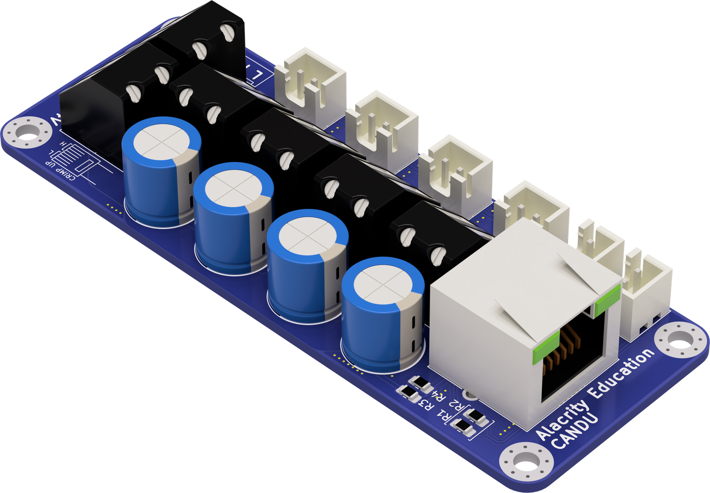
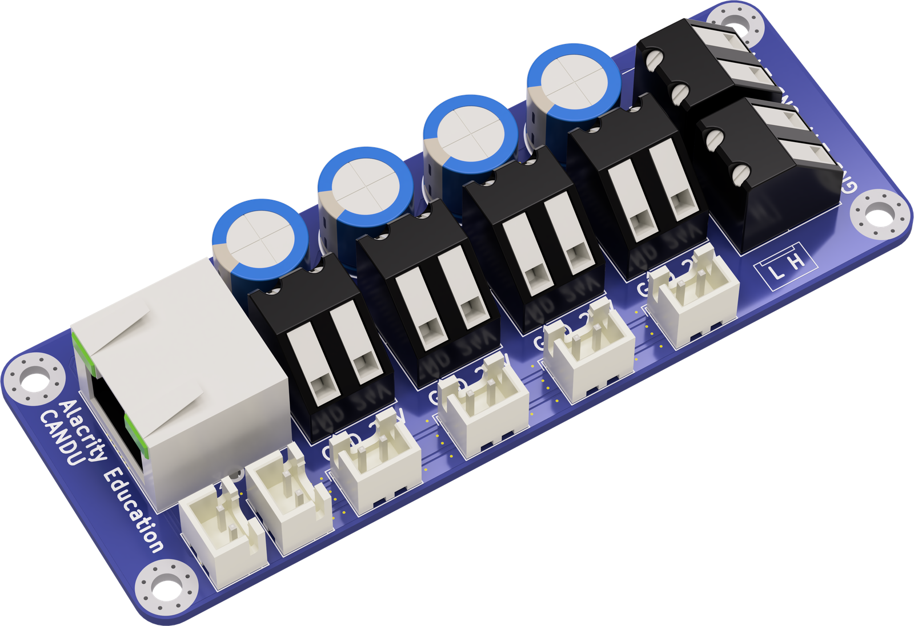
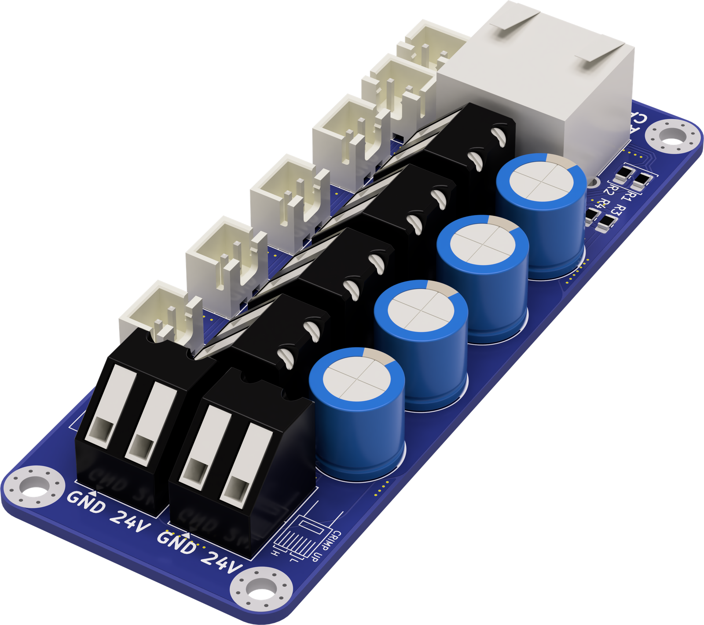
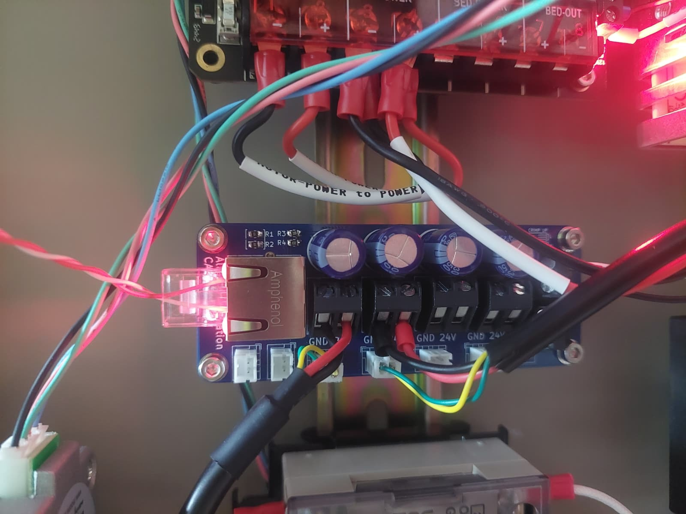
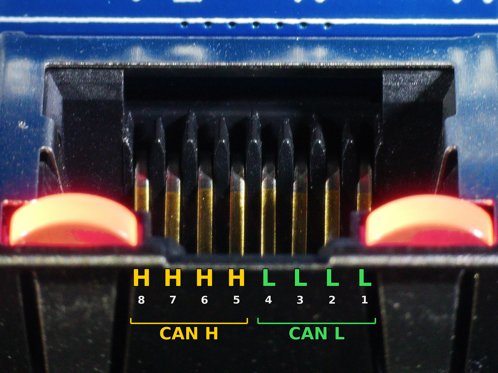
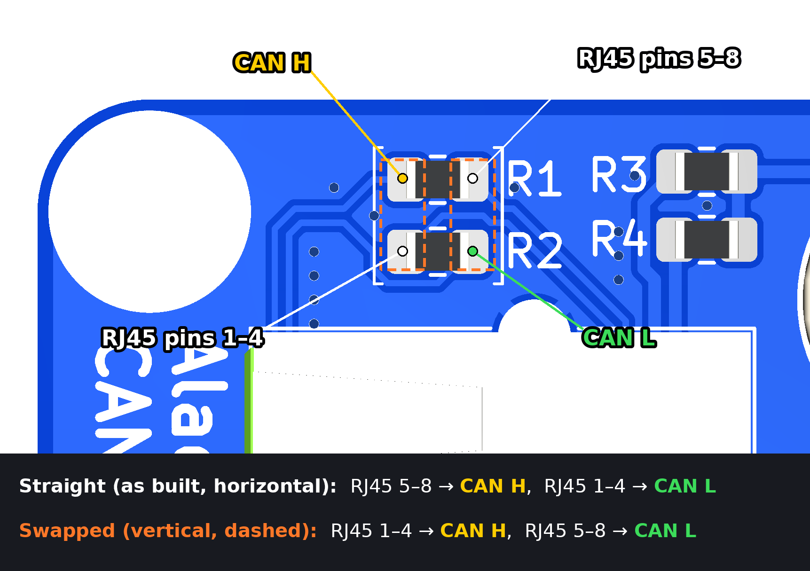

# CANDU V1.1

CAN DistribUtor is a board that distributes CAN and 24V power to multiple
toolheads or CAN devices, like ERCF MMUs.

The board has no active parts: every CAN connector is on the same bus, and
every power terminal is on the same 24V rail.

|  |  |  |
| -- | -- | -- |

## Ports

- 1x Power Uplink
- 1x CAN Uplink, by RJ45 connector
- 4x CAN+Power Downlinks to end devices
- 2x Extra CAN Downlinks
- 1x Power Downlink
- Power indicator LED: the LEDs in the RJ45 jack light up when the board has
  24V.

The board is self-documenting: crimping instructions and pinouts are printed
on the silkscreen.

## RJ45 pinout

4 pins of the RJ45 are mapped to CAN H, and the other 4 to CAN L.

## Swapping CAN H and L on the RJ45

The CAN L-H pair coming from the RJ45 jack can be swapped by rotating the
resistor placement near the jack by 90 degrees. R1 and R2 are two 0 Ω links
whose four pads form a square:

- **Straight (as built):** both links horizontal. RJ45 pins 5-8 go to CAN H,
  pins 1-4 to CAN L.
- **Swapped:** both links vertical, on the dashed outlines. RJ45 pins 1-4 go
  to CAN H, pins 5-8 to CAN L.

The swap only affects the RJ45 uplink.

## Notes

- The CAN bus needs a 120 Ω terminator at each end. The board has none, so terminate at the host and at the last device.
- If using long cables to the 2-4 devices, terminate at two devices instead of at the host. In this case, make sure the CANDU-Host cable is short.
- Four 330 µF high-quality capacitors (C1-C4) buffer the 24V rail.
- M3 mounting holes are connected to GND.
