# INDXWorx V0.1

An adapter that connects the Bondtech INDX Prusa head to a Klipper printer. It
is designed to plug into the BTT Octopus mainboard.

The head talks RS485. The board carries an ST STR485, a very high quality
RS485 transceiver, and gives the head switchable 5V power.

| 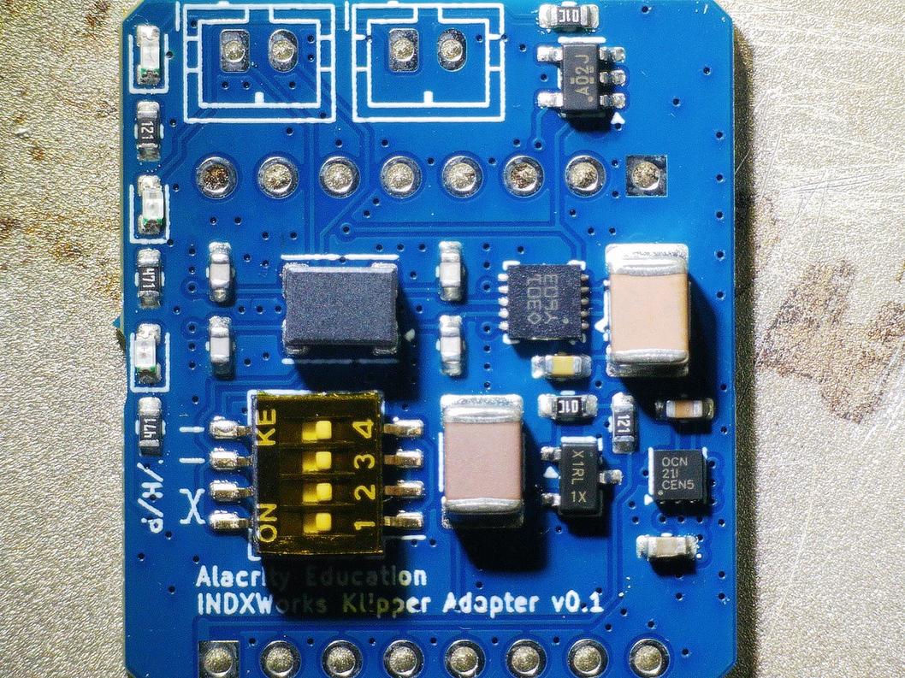 | 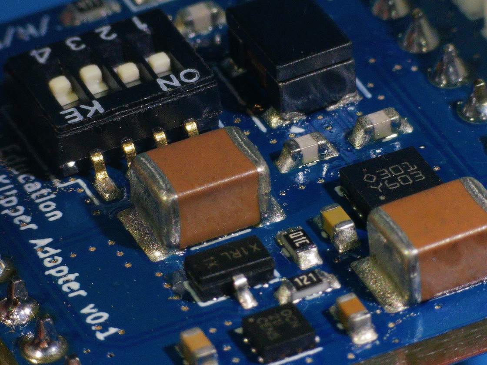 |
| -- | -- |

## Features

- **RS485** through the ST STR485 transceiver, with 120 Ω termination on the
  board.
- **Very good ESD protection and common-mode rejection** on the RS485 line: a
  common-mode choke (Murata DLW43SH), an ESD protection diode (NUP2105L) and
  100 pF C0G filter capacitors.
- **Clean supplies:** a TI TPS60151 flying-capacitor charge pump makes a clean
  5V from the Octopus 3.3V, and an MCP1825 LDO makes the board's own 3.3V.
- **Switchable 5V head power**, through a P-MOSFET.
- **LEDs** for board power, 5V head power and RS485 activity.
- **RS485 line swapper:** a DIP switch poka-yoke, so the two RS485 lines can be
  swapped without re-crimping the cable.

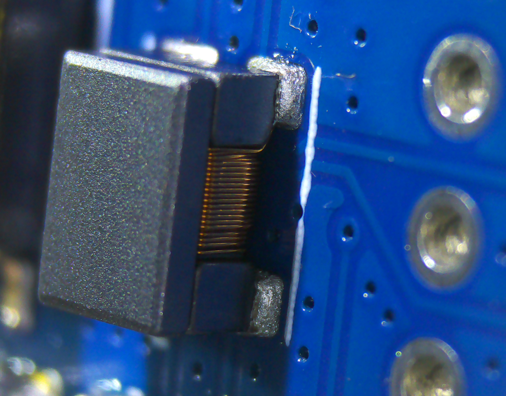

## Connections

### Octopus

The board plugs into the Octopus WiFi socket. It uses these Octopus pins:

| Octopus pin | Function |
| -- | -- |
| PD5 (TX3) | RS485 transmit |
| PD6 (RX3) | RS485 receive |
| PD7 | RS485 driver enable (DE) |
| PD10 | RS485 receiver enable (/RE, active low) |
| PG7 | Head 5V switch: on by default, drive high to switch the head off |

### Head

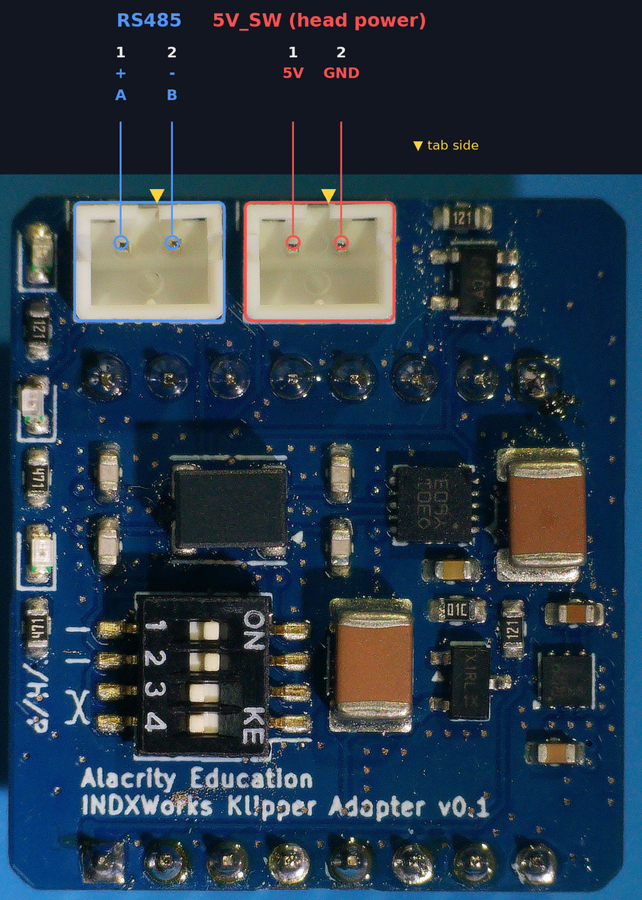

## RS485 line swapper

The silkscreen next to the DIP switch shows the two settings:

- **Straight (`| |`):** the two switches next to `| |` ON, the two next to
  `X` OFF.
- **Swapped (`X`):** the two switches next to `X` ON, the two next to `| |`
  OFF. The head's two RS485 lines are crossed.

Go by the silkscreen marks, not the numbers on the switch: the switch can be
fitted either way round.

Use one pair at a time: turning on all four switches shorts the RS485 lines.

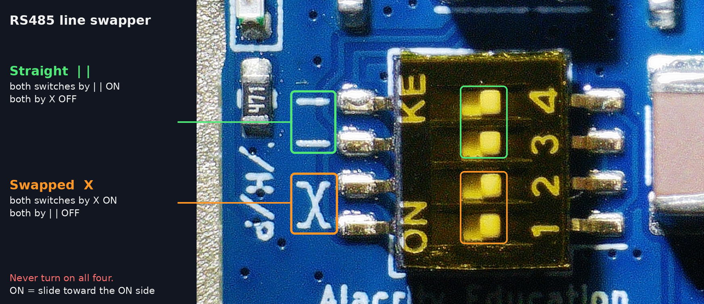

## LEDs

The silkscreen `T/H/P` names the three LEDs:

- **T** (blue): traffic, RS485 activity.
- **H** (red): head power, the switched 5V to the head is on.
- **P** (orange): board power.

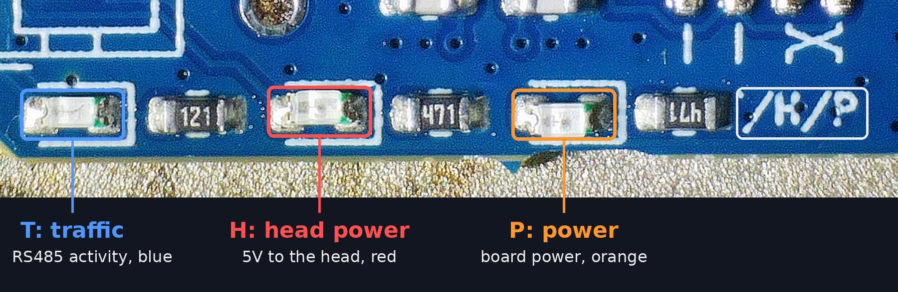

## Options

- `JP4` (`SLR`, on the back) is a solder jumper, open by default. Closing it
  ties the STR485 slew-rate pin to 3.3V; see the STR485 datasheet.

## Gallery

| 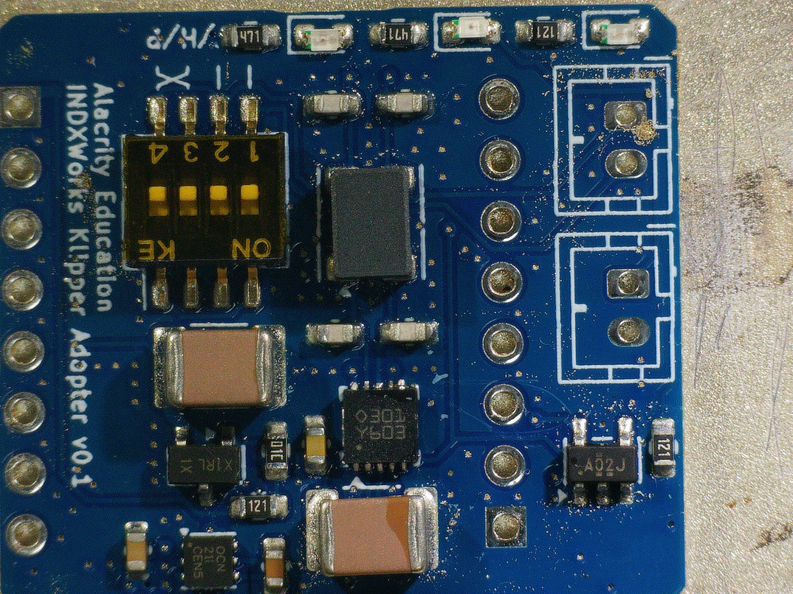 |  |
| -- | -- |
| 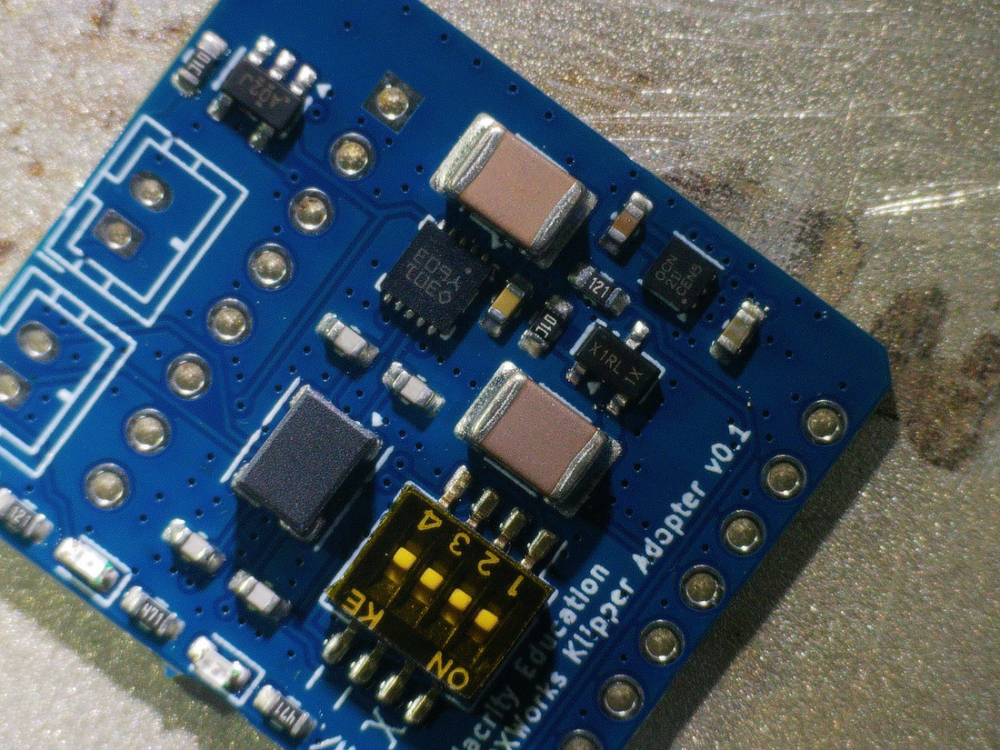 | 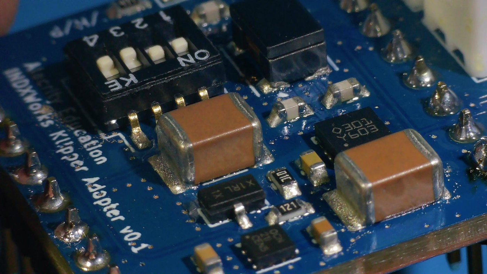 |
| 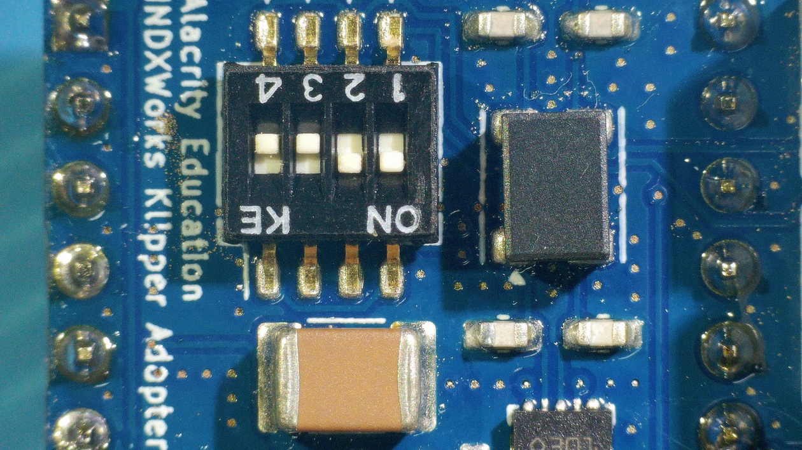 | 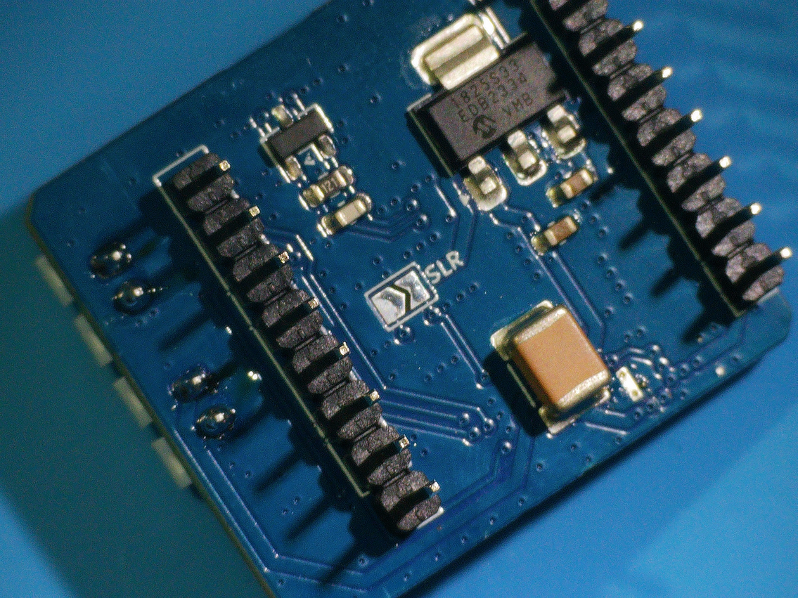 |
