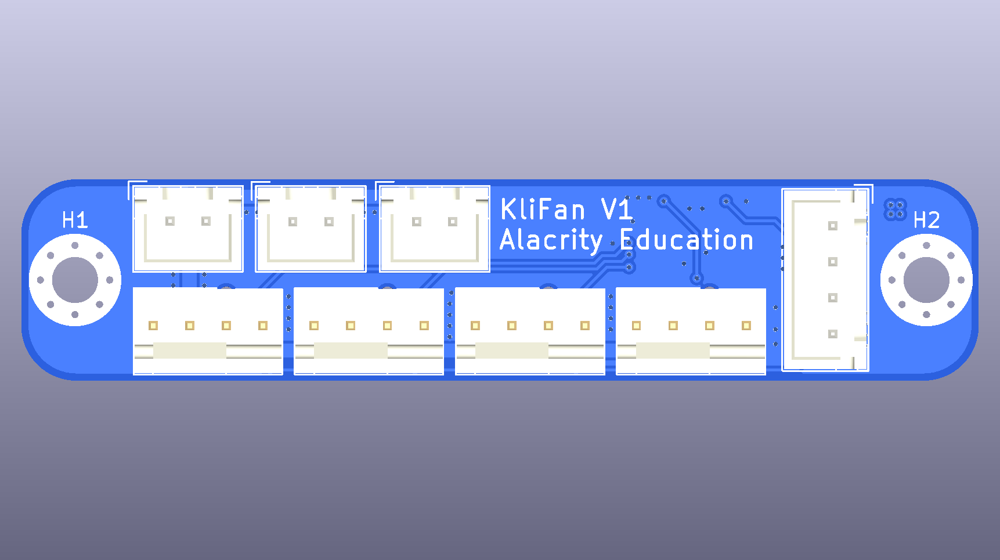
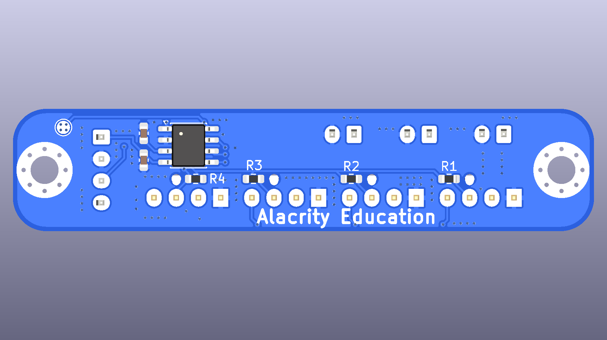
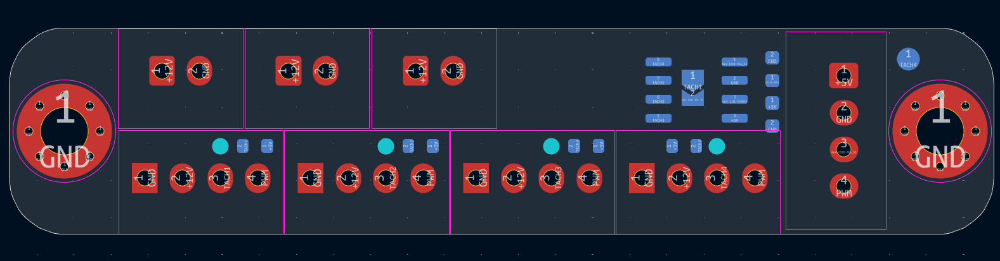

# KliFan V1

A fan hub for Klipper printers. One PWM signal from the motherboard drives four
4-pin PWM fans, and a tiny microcontroller (STM8S001J3) reads the four tach
lines so the printer can watch the fans through a single endstop input. The
board takes 12 V through one of its three 2-pin headers; the other two take
always-on 12 V fans.

|  |  |
| -- | -- |



## Pinout

### J11: printer connection (JST-XH, 4-pin)

The vertical connector at the end of the board. It goes to the motherboard:
pins 1-3 to an endstop port, pin 4 to a free digital output.

```
              +-------+
  +5V    1 ---| [■]   |      <-- endstop port, 5V
  GND    2 ---| (o)   |]     <-- endstop port, GND
  TACH   3 ---| (o)   |]     --> endstop port, signal  (tach_out)
  PWM    4 ---| (o)   |      <-- motherboard digital output pin (fan PWM)
              +-------+
                       ^
                       tab
```

### Fan headers

The four 4-pin headers are PC-fan compatible: any standard 4-pin PWM PC fan
plugs straight in. Their speed follows the PWM signal on J11 pin 4, and the
microcontroller reads each fan's tach line.

The three 2-pin headers are standard 3D-printer 12 V fan headers, all wired
in parallel. One of them must be connected to an always-on 12 V fan header on
the motherboard, or directly to the 12 V supply: this powers the whole board,
including the 4-pin fans. J9 is marked `SUPPLY` for this, but any of the three
works. The other two take always-on fans, which run at full speed whenever
the board has 12 V.

The mounting holes H1 and H2 are connected to GND.

### Programming and options

- `TP1` (`SWIM`) is the programming pad. It shares the STM8 pin with TACH4.
- `JP1` is a solder jumper, open by default. Closing it connects TACH1 straight
  to J11 pin 3, so the board can be used without the microcontroller.

## Firmware

Not written yet.
