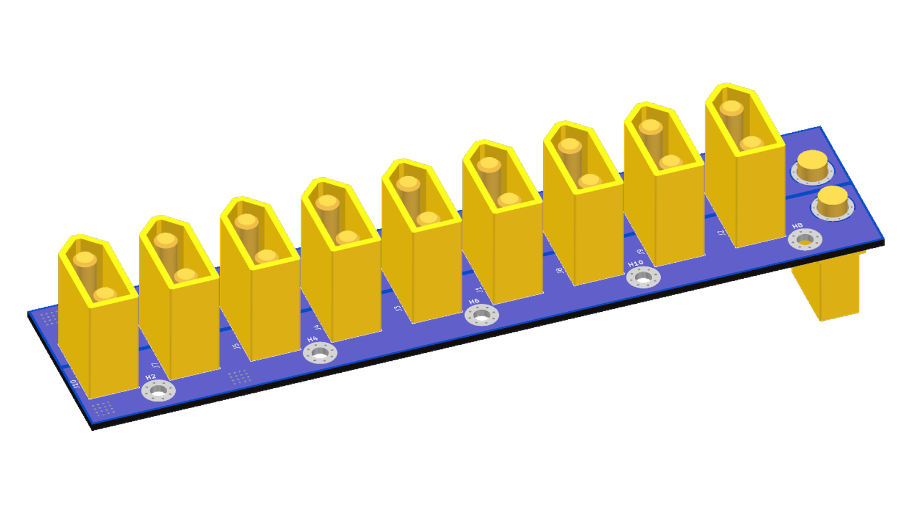
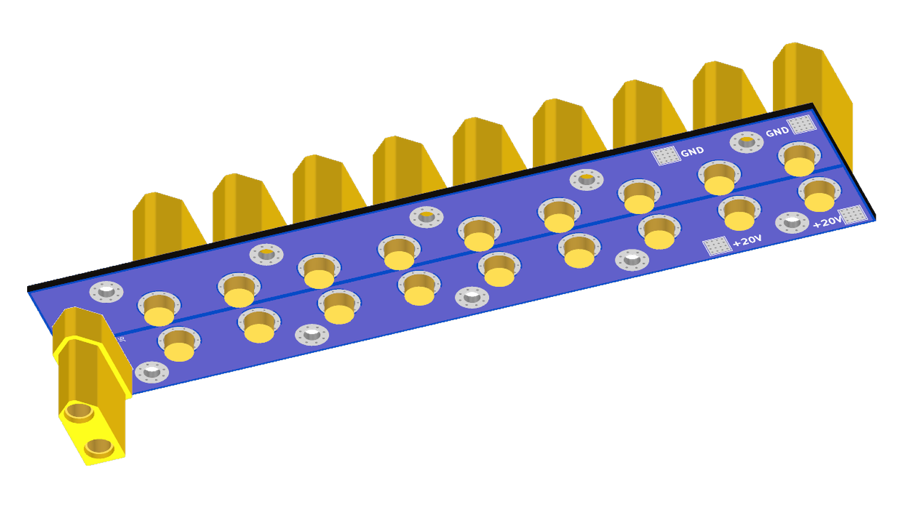
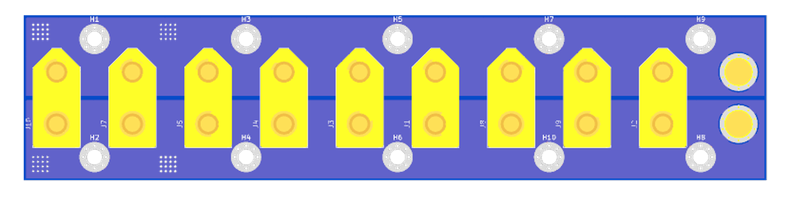
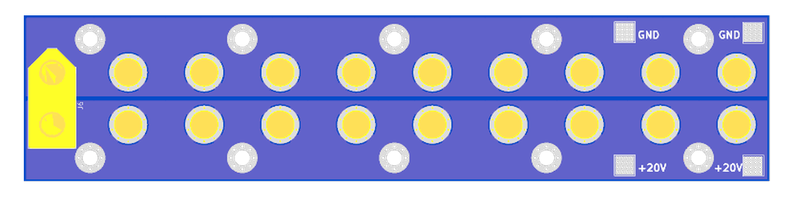

# PDU20V

A rack power distribution board. It takes 20V from one big supply and shares
it out to the mini PCs and other devices in the rack, over XT90 connectors.

|  |  |
| -- | -- |

## Connectors

- **PSU side (J6, back of the board)**: one female AMASS XT90, for the lead
  from the 20V supply.
- **Outputs (J1-J5, J7-J10, front)**: nine male AMASS XT90s, one per mini PC
  or device.
- **Solder pads (TP1-TP4, back)**: two `+20V` and two `GND` 4×4mm pads, for
  wiring the supply or measuring.

All connectors are in parallel: every output gets the full 20V rail. There is
no fuse or switch on the board.

|  |
| -- |
|  |

## Mounting

The ten M3 holes are not isolated: the five along one long edge are on `+20V`
and the five along the other are on `GND`. Mount the board with nylon
standoffs or screws, or it will short the supply against a metal rack.

## Mini PCs

We use it with Dell OptiPlex 3060 Micro PCs. Fed from a shared supply instead
of the Dell charger, their BIOS throttles the CPU to 800 MHz.
[Dell3060ForcePower](https://github.com/Alacrity-Education/Dell3060ForcePower)
restores full clocks and turbo at every boot.

We use this board in our rack to save space and power: all the mini PCs run
from a single supply instead of one power brick each.
