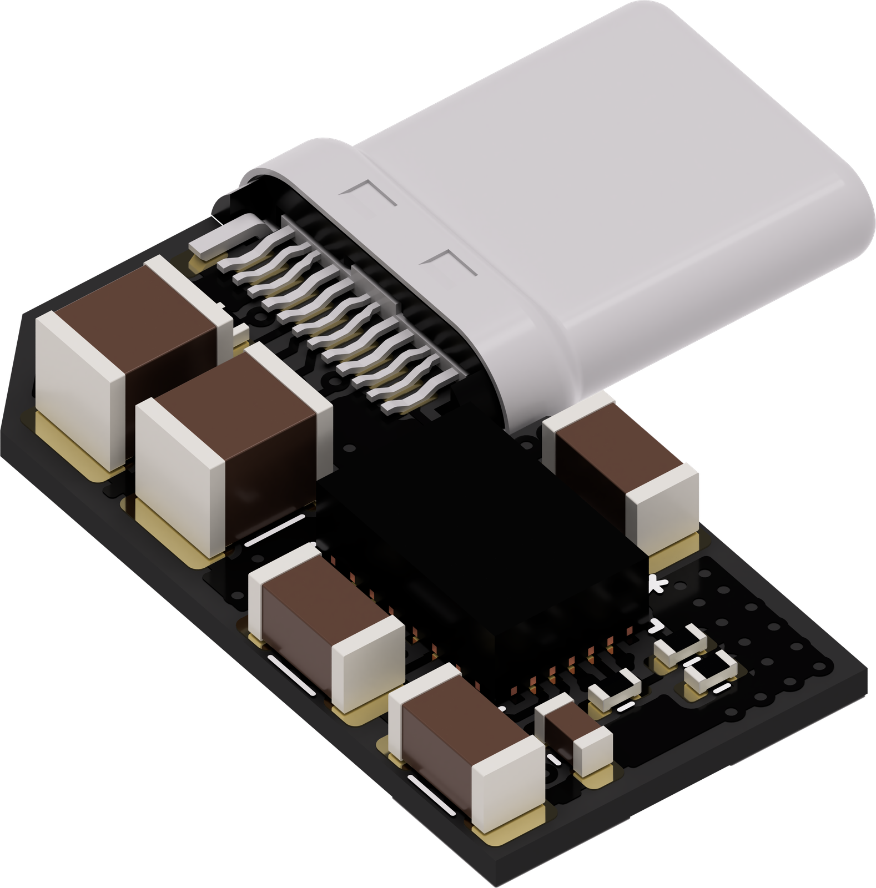
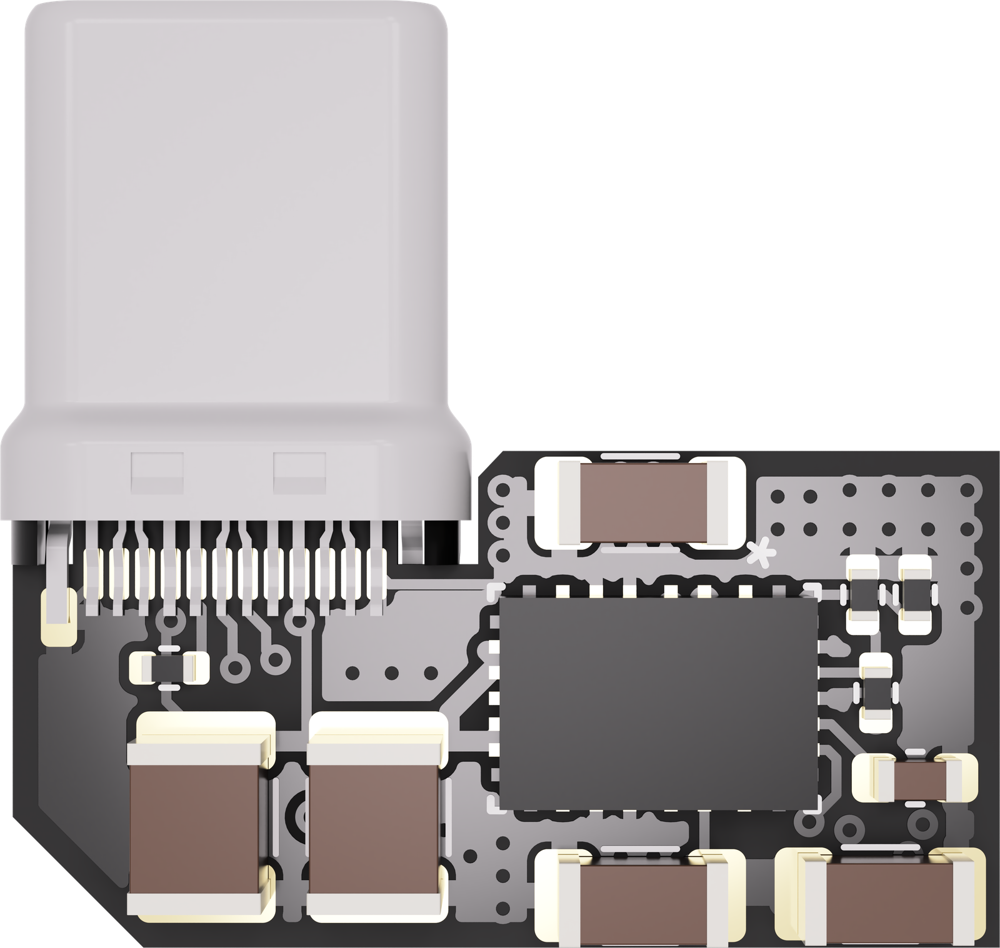
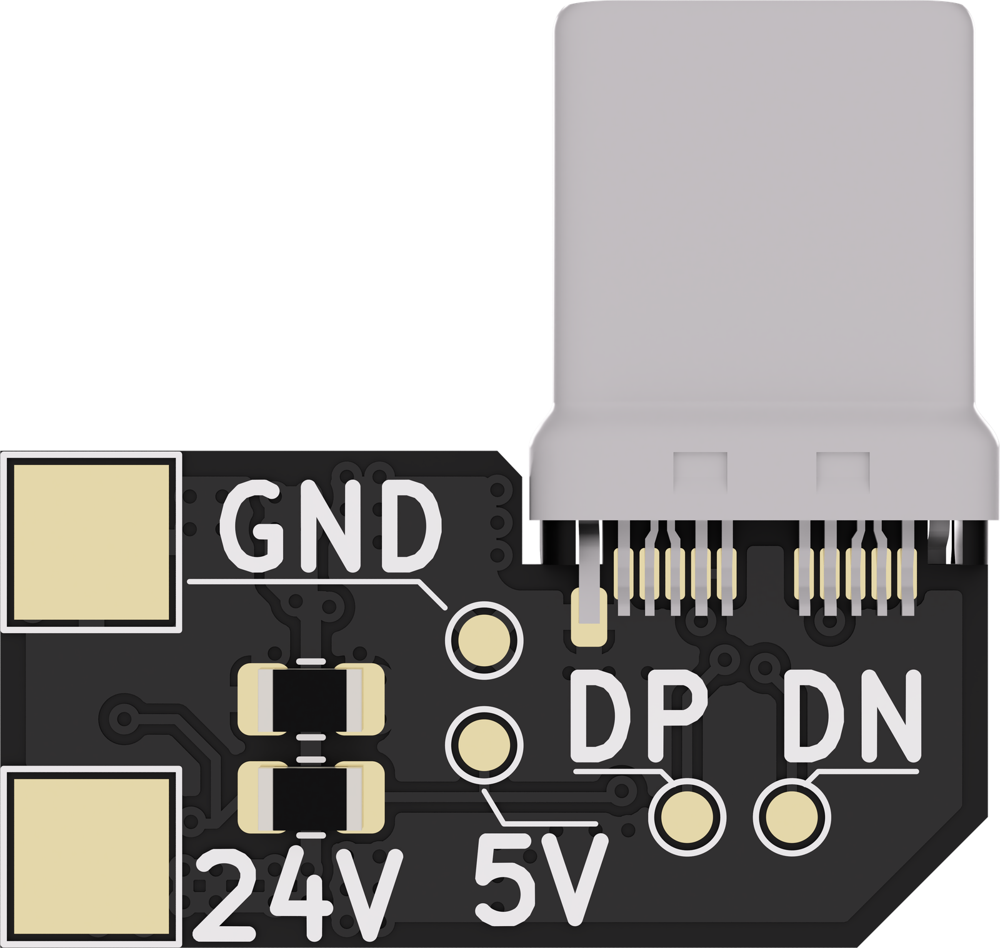
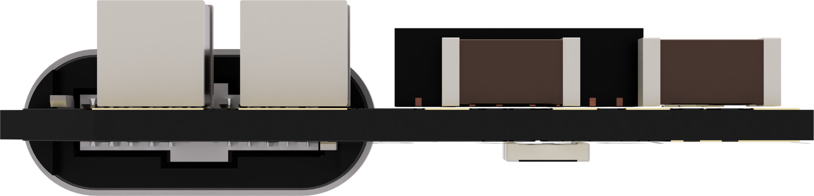
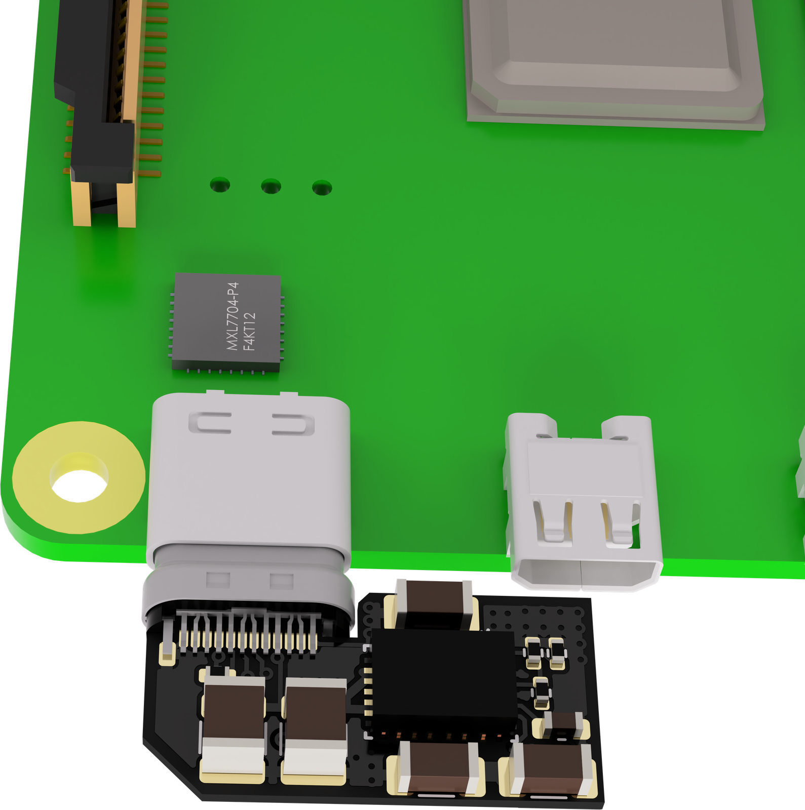
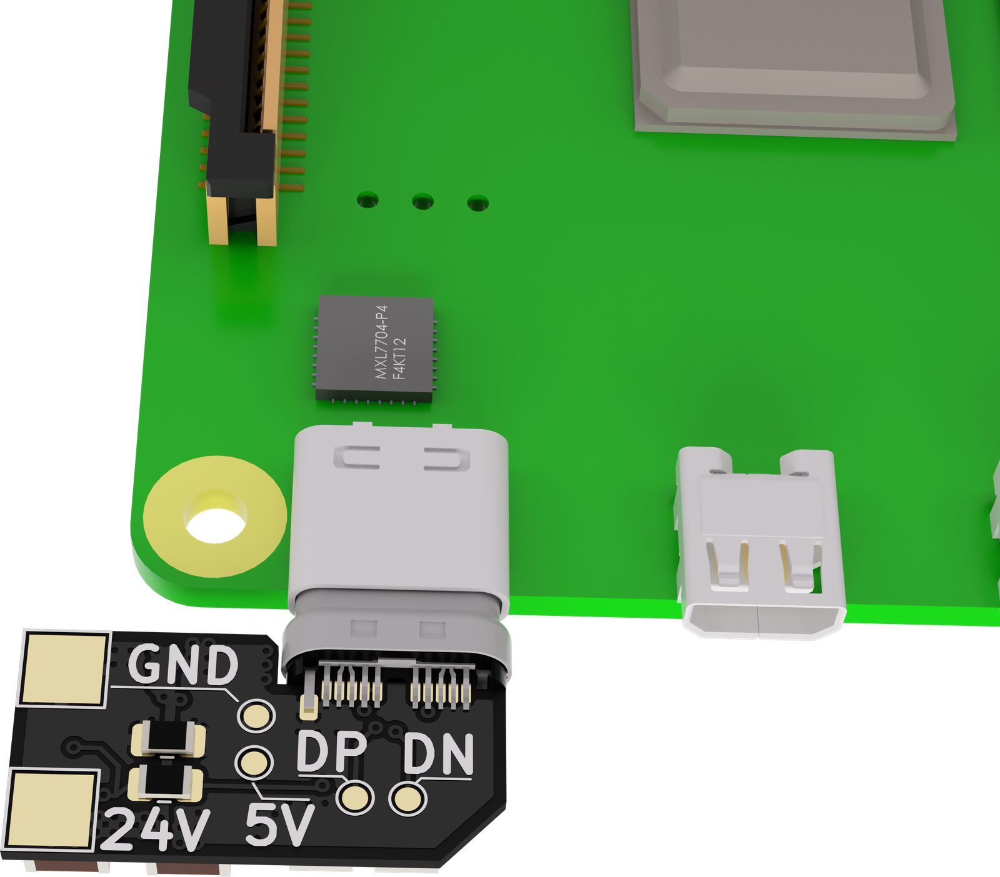

# PIPSU

A tiny PSU for Raspberry Pi boards. It plugs straight into the Pi's USB-C
port and supplies 5V, up to 3A, from the printer's 24V supply line (it accepts
8-30V). We built it to take the Raspberry Pi's power draw off the mainboard's
regulator and use a more stable supply instead.

|  |  |  |
| -- | -- | -- |

The board uses TI's TPSM63603, an ultra-integrated power module, to keep the
footprint very small. Its high efficiency keeps the temperature manageable at
full load, on a very small board with completely passive cooling.

## Connections

All the pads are on the back of the board:

- **24V** and **GND** (large pads): the input from the printer's 24V supply
  (8-30V).
- **5V** and **GND** (small pads): 5V out, for powering peripherals.
- **DP** and **DN**: the USB 2.0 data lines of the USB-C plug, for connecting
  a USB device to the Pi.

The USB-C plug advertises a 3A source to the Pi on its CC line.

|  |  |
| -- | -- |
