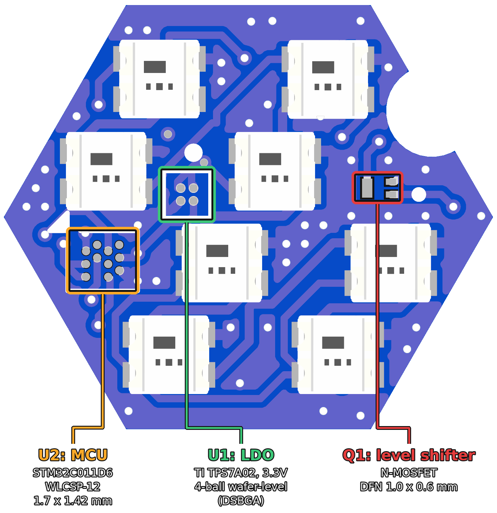
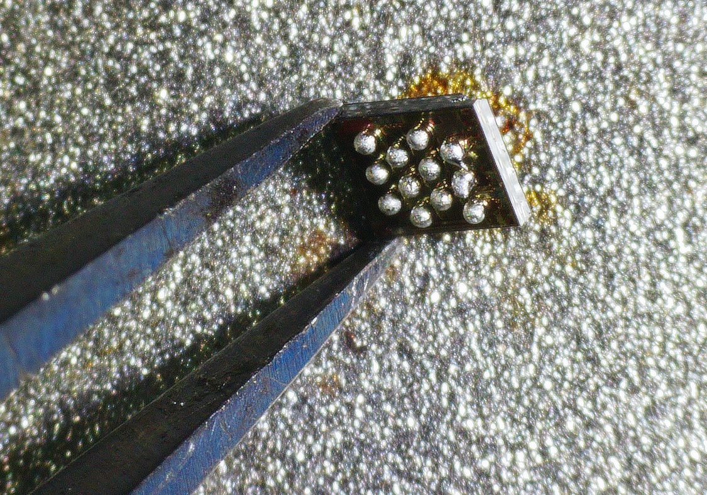

# RBARF V0.2

The second revision of [RBARF](../RBARF-V0.1). The STM8 is replaced by an
STM32C011D6 (WLCSP-12), powered by a TI TPS7A02 3.3V LDO, with an N-MOSFET
(Q1) as a level shifter.

We used these very small wafer-level components so that all the parts fit on
a single side of the board, which makes assembly easier.

The STM32C011D6 in tweezers, ball side up. The whole chip is 1.7 × 1.42 mm,
with 12 solder balls on a 0.35 mm pitch. It is a wafer-level package: the
balls sit directly on the silicon die, and the silicon layers are visible on
the ball side.

Programming and debug pads: `SWDIO`, `SWCLK` and `UART`.

**Known issue:** the Q1 footprint is wrong. It is fixed in
[RBARF V0.3](../RBARF-V0.3).

## Q1 repair

The MOSFET does not fit its footprint: its pads end up outside the part. We
repaired the boards by extending the pads with short sections of wire, glued
down to the board with UV-curable solder mask, then soldering the MOSFET onto
the extended pads.

|  |  |  |
| -- | -- | -- |
| Before: the pads end up outside the MOSFET | Pads extended with wire, UV solder mask | After: the repaired board |

## Firmware

V0.2 runs the [V0.3 firmware](../RBARF-V0.3/firmware).
