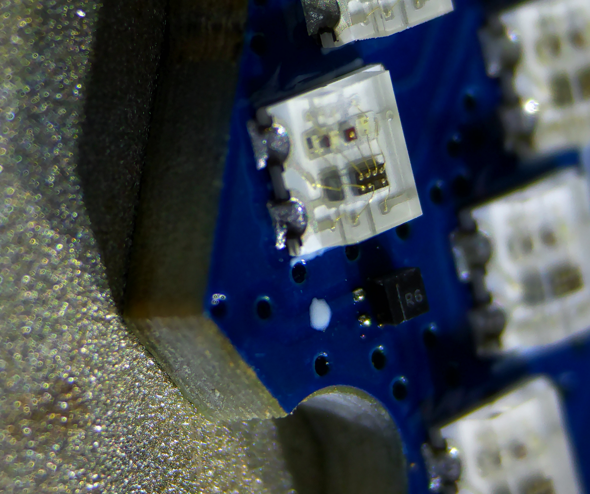
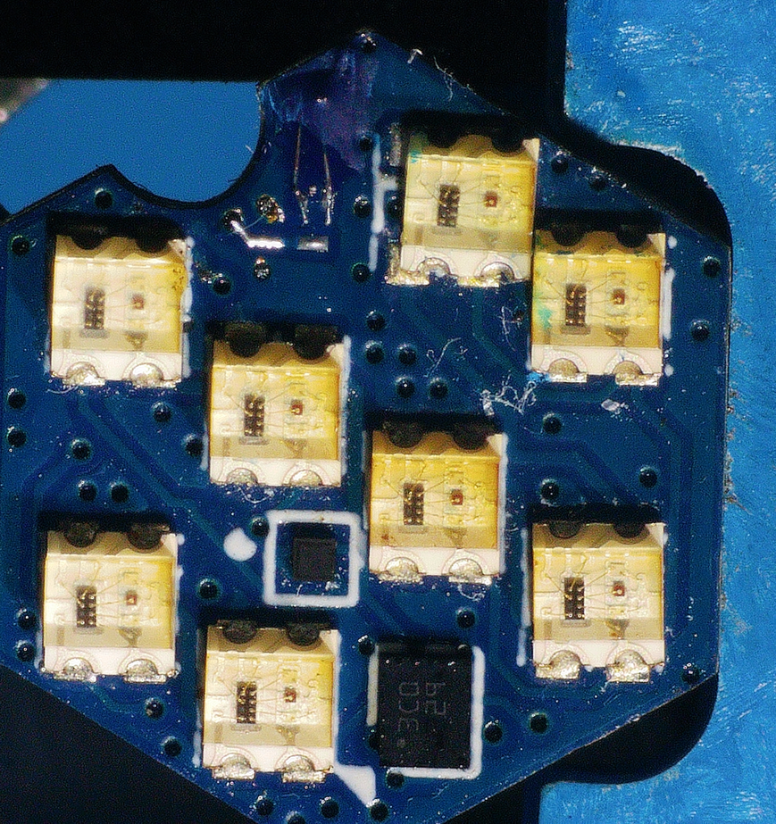
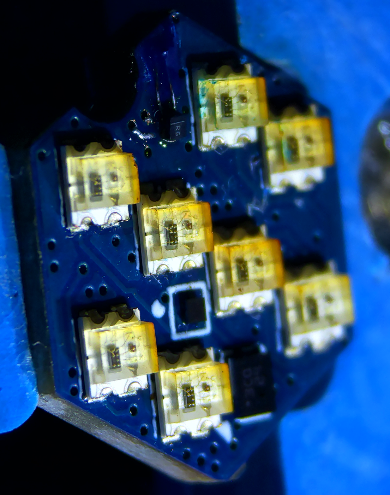

# RBARF V0.2

The second revision of [RBARF](../RBARF-V0.1). The STM8 is replaced by an
STM32C011D6 (WLCSP-12), powered by a TI TPS7A02 3.3V LDO, with an N-MOSFET
(Q1).

Programming and debug pads: `SWDIO`, `SWCLK` and `UART`.

**Known issue:** the Q1 footprint is wrong. It is fixed in
[RBARF V0.3](../RBARF-V0.3).

## Q1 repair

The MOSFET does not fit its footprint: its pads end up outside the part. We
repaired the boards by extending the pads with short sections of wire, glued
down to the board with UV-curable solder mask, then soldering the MOSFET onto
the extended pads.

|  |  |  |
| -- | -- | -- |
| Before: the pads end up outside the MOSFET | Pads extended with wire, UV solder mask | After: the repaired board |

## Firmware

Rust + Embassy, in `firmware/`. See [firmware/README.md](firmware/README.md).

```sh
cd firmware
cargo build --release
cargo run --release    # flash with probe-rs
```

The C parity test (`cargo test-anim`) compiles the V0.1 animation engine from
`RBARF-V0.1/firmware/app/`.
