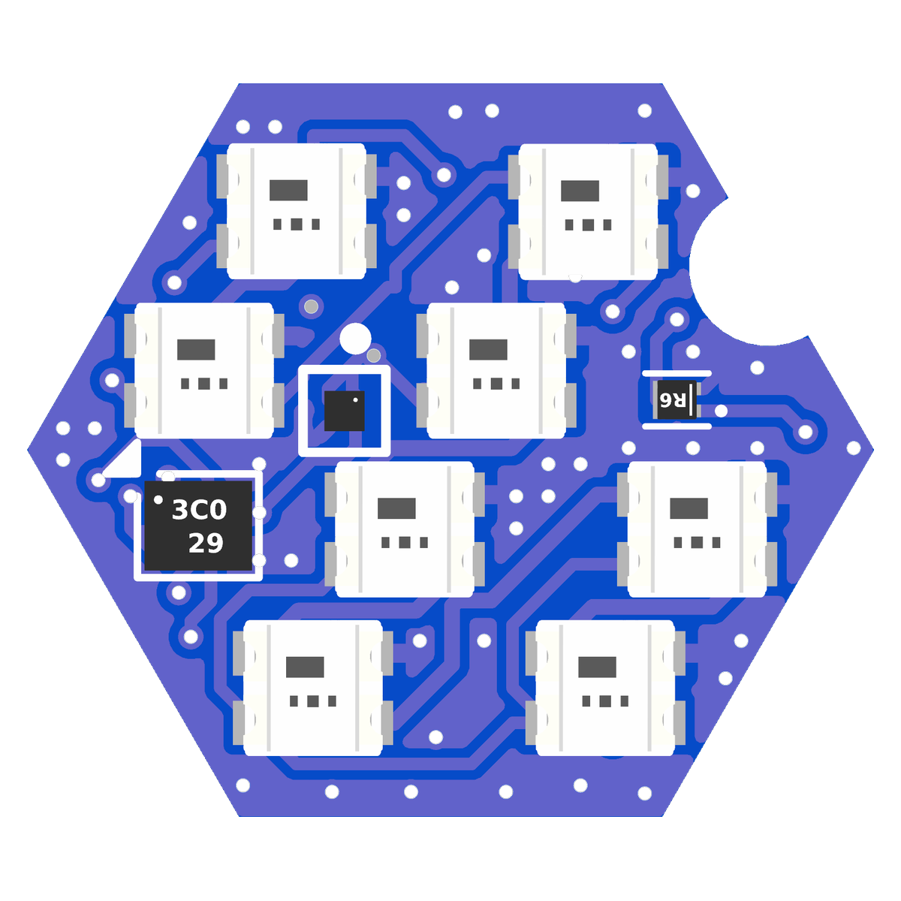
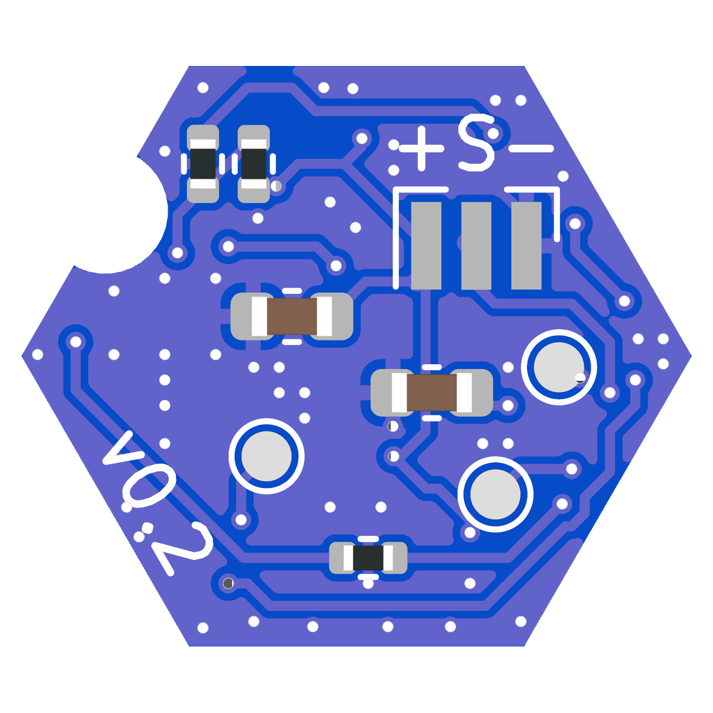

# RBARF V0.3

The same board as [RBARF V0.2](../RBARF-V0.2) (STM32C011D6, TPS7A02 LDO), with
the Q1 MOSFET footprint fixed.

Programming and debug pads: `SWDIO`, `SWCLK` and `UART`.

|  |  |
| -- | -- |

## Firmware

Rust + Embassy, in `firmware/`. See [firmware/README.md](firmware/README.md).

```sh
cd firmware
cargo build --release
cargo run --release    # flash with probe-rs
```

The C parity test (`cargo test-anim`) compiles the V0.1 animation engine from
`RBARF-V0.1/firmware/app/`.

The same firmware runs on [V0.2](../RBARF-V0.2).
