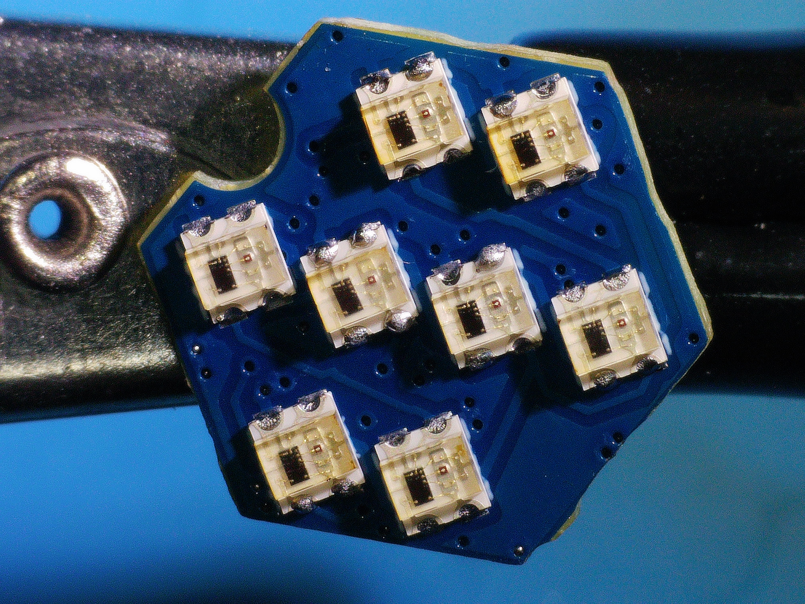
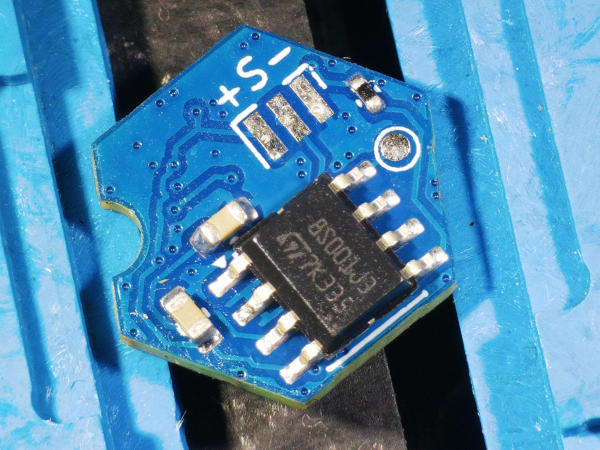
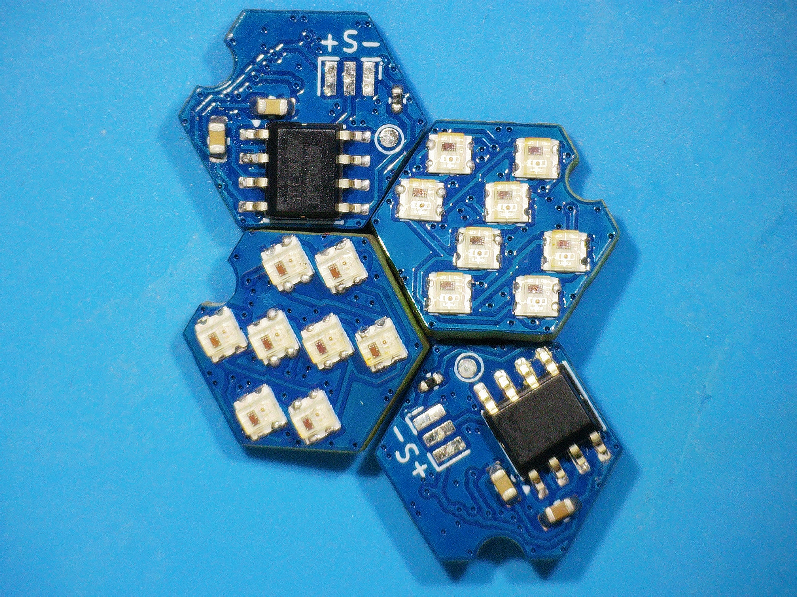

# RBARF V0.1


Built on the wonderful [Rainbow Barf Logo LED](https://github.com/VoronDesign/VoronUsers/tree/main/printer_mods/VinnyCordeiro/RGB_LED_grid_for_SB) by VinnyCordeiro, we have added a tiny microcontroller to the back of the board. 

Klipper can control Neopixels just fine, but animations can be demanding to klipper's resources. We implemented a way to create animations locally on the LED board.
For this purpose, the LED signal coming from klipper is intercepted by a tiny microcontroller (STM8S001J3). This microcontroller presents itself to the host as a 10-led group, where the first 8 leds are the 8 real on the board, and the next 2 virtual leds (6 bytes) are metadata for creating simple animations (blink, fade, wave, etc) on top of the given color data.

The board includes a single pad for `SWIM` programming.

|  |  |  |
| -- | -- | -- |

# Firmware

Version 0.1 has a major flaw: a 16MHz 8-bit microcontroller has to read a few hundred bits coming as variable-length PWM pulses at 800KHz. 

This gives us exactly 20 cpu cycles to read a whole pulse. To make it happen, we are reading raw GPIO values as fast as possible in the memory (like an oscilloscope) and then decoding them offline. We wrote a [blog post](https://blog.alacrity.ro) on this challenge.

The `reference/` folder contains a C version of the firmware. Because the algorithm is very complex, it does not fit in the available flash and RAM. The final firmware is manually-written STM8 assembly written to achieve data parity with the C firmware. 

## Build and flash

Needs SDCC 4.6.0 (other versions are refused), `stm8flash` and an ST-LINK/V2 wired to the board: SWIM → `SWIM` pad, TVCC → 3.3 V, GND → GND.

```sh
cd firmware
make build/rbarf_prod.ihx
# power the board, then within 5 s:
stm8flash -c stlinkv2 -p stm8s001j3 -w build/rbarf_prod.ihx
```

The `SWIM` pad is only programmable during the first 5 s after power-on.

